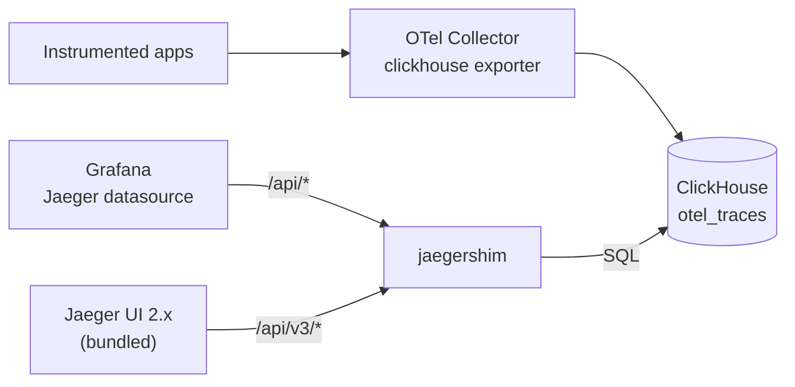

# jaegershim-clickhouse

[](https://github.com/nochaosio/jaegershim-clickhouse/actions/workflows/ci.yml)
[](https://github.com/nochaosio/jaegershim-clickhouse/releases)
[](LICENSE)

`jaegershim` is a Jaeger Query compatibility layer for OpenTelemetry traces stored in ClickHouse.
It reads the `otel_traces` table written by the OTel Collector
[`clickhouse` exporter](https://github.com/open-telemetry/opentelemetry-collector-contrib/tree/main/exporter/clickhouseexporter)
and serves the Jaeger HTTP APIs plus the Jaeger UI on top of it.

Your Jaeger UI and Grafana Jaeger datasources keep working, and the spans stay where they already are.
You don't need a second copy, a new schema or another pipeline.

> **Status:** beta (v0.1). Its responses match real Jaeger in 267 of 267 side-by-side scenarios, but it
> has not been proven in large production deployments yet. Validate it against your own workload first.

jaegershim only reads. It is **not** a collector, a trace store or a replacement for the Jaeger binary:
it turns Jaeger queries into ClickHouse SQL and returns Jaeger-shaped JSON.

## Where it fits



Why it exists:

- **Grafana's Jaeger datasource uses the legacy `/api/*` API, which Jaeger removed in 2.22.** jaegershim
  serves both the legacy API and v3, so Grafana and the current Jaeger UI work against the same data.
- It works on the OTel schema you may already share with ClickStack/HyperDX and the Grafana ClickHouse
  plugin. Jaeger's own ClickHouse backend is still alpha and uses a different schema.

## Quick start

```bash
docker run -d -p 16686:16686 \
  -e CLICKHOUSE_ADDR=clickhouse:9000 \
  -e CLICKHOUSE_USER=jaeger_reader -e CLICKHOUSE_PASSWORD=change-me \
  ghcr.io/nochaosio/jaegershim-clickhouse:latest
```

To get the Jaeger UI, open http://localhost:16686. For Grafana, add a **Jaeger** datasource that points
at `http://<host>:16686`.

To try a full local stack with ClickHouse, the OTel Collector, Grafana, HyperDX and load generators:

```bash
cd examples/stack && cp .env.example .env && docker compose up -d
```

## API

| Endpoints | Used by |
|---|---|
| `/api/services`, `/api/operations`, `/api/traces`, `/api/traces/{id}`, `/api/dependencies` | Grafana (legacy API) |
| `/api/v3/services`, `/api/v3/operations`, `/api/v3/traces`, `/api/v3/traces/{id}` | Jaeger UI 2.x |
| `/health`, `/` | probes, bundled UI |

Search works the way it does in Jaeger. Every filter must match the same span, and the results are whole
traces. Tags match span, resource and event attributes. jaegershim also reproduces Jaeger's adjusters:
Zipkin shared span IDs, orphan warnings, empty names, zero durations and 64-bit trace IDs.
See [docs/compatibility.md](docs/compatibility.md).

## Configuration

| Variable | Default | Notes |
|---|---|---|
| `CLICKHOUSE_ADDR` | `localhost:9000` | native protocol |
| `CLICKHOUSE_USER` / `CLICKHOUSE_PASSWORD` | `default` / empty | use a read-only user |
| `CLICKHOUSE_DATABASE` | `default` | |
| `TRACES_TABLE` / `TRACES_ID_TS_TABLE` | `otel_traces` / `otel_traces_trace_id_ts` | exporter defaults |
| `QUERY_TIMEOUT` | `25s` | keep it below the user's `max_execution_time` |
| `SERVICES_LOOKBACK` | `168h` | how far back to look for services and operations |
| `EXTENDED_TAG_SEARCH` | `false` | enables search on `otel.status_*` and `otel.scope.*` |
| `CLICKHOUSE_MAX_OPEN_CONNS` | `10` | |
| `LISTEN_ADDR` / `UI_DIR` | `:16686` / `/ui` | an empty `UI_DIR` disables the UI |

Run it as a read-only ClickHouse user with server-side limits. A ready-to-use example is in
[02-jaeger-reader.sql](examples/stack/clickhouse/initdb/02-jaeger-reader.sql). The Jaeger UI has no
login, so put jaegershim behind TLS and an authenticating proxy.

## Compatibility

The OTel Collector sends the same traces to jaegershim and to real Jaeger: 2.20 for the legacy API and
2.23 for v3. The suites then compare the complete responses through Grafana, both APIs and the UI.

| Suite | Result |
|---|---|
| [`jaeger_compat.py`](test/compat/jaeger_compat.py): 30 multi-service traces | 83/83 identical |
| [`jaeger_compat_varied.py`](test/compat/jaeger_compat_varied.py): 24 edge cases (1,500-span traces, orphans, links, clock skew, unicode and more) | 184/184 identical |

**Known gaps:** attribute types come back as strings because the exporter stores them as
`Map(String,String)`. There is no archive storage, deep dependency graph or SPM tab. Dependencies are
computed at query time, which is expensive over long windows.

## Development

```bash
go test -race ./...                 # unit and HTTP contract tests
docker build -t jaegershim .        # multi-arch image with the official Jaeger UI assets
```

Read [CONTRIBUTING.md](CONTRIBUTING.md) before you open a PR. The plans are in
[docs/roadmap.md](docs/roadmap.md).

## License

Apache-2.0. See [LICENSE](LICENSE) and [NOTICE](NOTICE). Jaeger is a trademark of The Linux Foundation;
this project is not affiliated with the Jaeger project, ClickHouse, Inc. or Grafana Labs.
